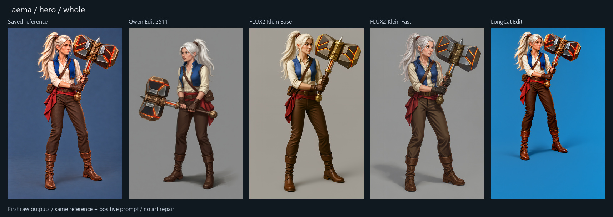
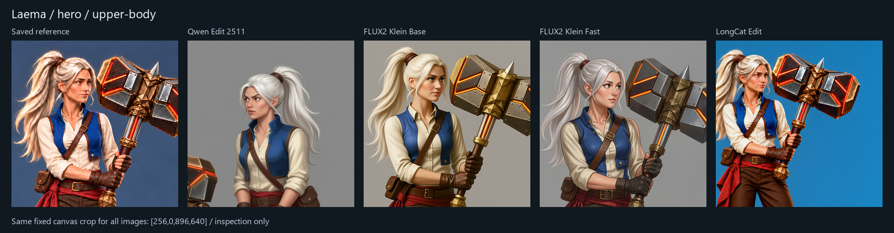
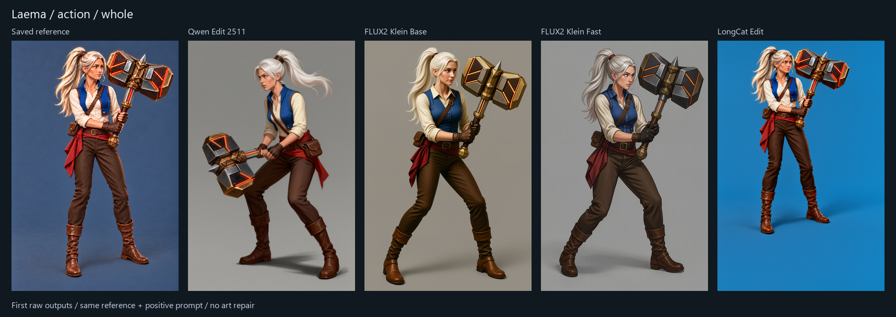
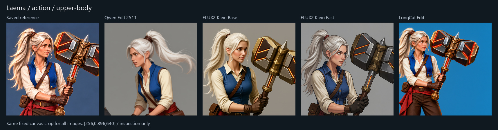
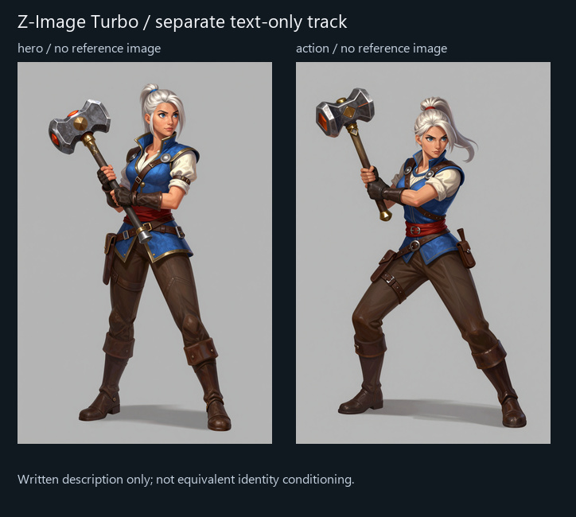

# Local model comparison — executed results

All ten first outputs completed on the RTX4090. No artistic winner or production method is accepted. Manual painting/repair performed before review:0seconds for every output. Time to an accepted asset remains unmeasured.

The same single saved Laema hero reference and positive prompt were used for Qwen, FLUX Base, FLUX Fast and LongCat. This is a new matched round; the earlier two-reference Qwen/built-in comparison is separate. Z-Image is a separately labelled text-only experiment and received no reference image. All outputs are1024x1536. Model-native sampling settings differ and are saved in each API graph.

## Review the artwork

The columns below are saved reference, Qwen, FLUX Base, FLUX Fast and LongCat. Whole-image comparisons use equal canvas scaling. Upper-body sheets use the exact same fixed crop on every image; no model-specific alignment or repair.

Z-Image's result belongs to a different input track:

Judge artistic finish, recognizable identity, face/expression, anatomy and hands, costume/hammer construction and response to the requested pose. No automatic aesthetic score substitutes for that review. Single outputs per cell do not establish statistical reliability or best possible quality.

## Observed request duration

| Configuration | Character | Action | Reference images |
| --- | ---: | ---: | ---: |
| Qwen Edit 2511 | 219.1s | 223.3s | 1 |
| FLUX2 Klein Base | 40.6s | 30.5s | 1 |
| FLUX2 Klein Fast | 15.2s | 5.2s | 1 |
| LongCat Edit | 142.1s | 121.8s | 1 |
| Z-Image (text only) | 35.8s | 15.3s | 0 |

These are request-through-save observations on this installation, including model loading where needed and5second polling. Later requests can benefit from caching. Model downloads ran concurrently during some requests. These are not controlled hardware speed benchmarks. Exact histories and sampled whole-GPU allocations are in each raw image's JSON record.

## Original files

- Qwen Edit 2511: [character PNG](qwen/raw/hero.png), [action PNG](qwen/raw/action.png)
- FLUX2 Klein Base: [character PNG](flux-base/raw/hero.png), [action PNG](flux-base/raw/action.png)
- FLUX2 Klein Fast: [character PNG](flux-fast/raw/hero.png), [action PNG](flux-fast/raw/action.png)
- LongCat Edit: [character PNG](longcat/raw/hero.png), [action PNG](longcat/raw/action.png)
- Z-Image (text only): [character PNG](z-image/raw/hero.png), [action PNG](z-image/raw/action.png)

## Scope and access limits

Five configurations across four model families were executed: Qwen, FLUX2Klein Base/Fast, LongCat and Z-Image. FLUX3Klein, FLUX2Klein9B and FLUX1Kontext were researched but not downloaded or run because their official repositories require gated access. SDXL/reference adapters, other checkpoints/LoRAs, and paid hosted alternatives are not tested here. This is a bounded first survey of practical native workflows, not a claim to have tested every image model.

The seven new model files total41,727,872,544bytes. All were pinned by repository revision and passed full-file SHA256 checks. The existing runtime and Qwen model were reused. Raw outputs and source references are untouched. No production asset, gameplay or canonical art decision was changed. No hosted image-generation calls were made for this survey.

The reusable Apps are installed in [the local ComfyUI package](../../ComfyUI-Laema/README.md). Model selection is a user choice; a working app is not art acceptance. See [method and source notes](README.md), experiment-plan.json, prompts.json, model-lock.json and repository-access.json for details.
