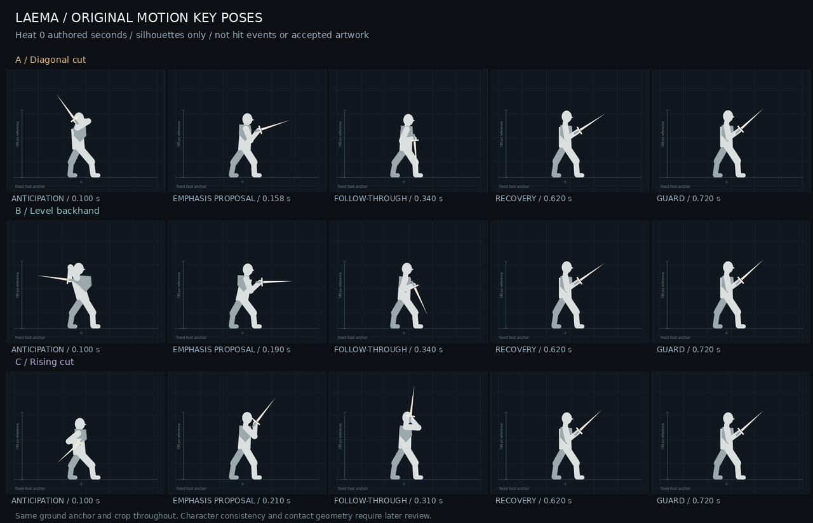

# Research Laema Animation Pipeline

Original-character animation R&D, 23 October 2026 (Hong Kong).

**Status: diagnosis complete; three original motion studies await user selection.** No polished production-method experiment or workflow winner is established. Publishing this research does not approve a motion or production artwork.

## Start here

- [Findings and technical contract](FINDINGS.md)
- [Local continuation prompt](CONTINUE_LOCAL.md)
- [Detailed illustrated report](report.html) — open locally in a browser.
- [Interactive A/B/C motion comparison](review.html) — offline HTML with embedded data.
- [Motion-study video](motion-studies.mp4) and [key-pose board](motion-keyposes.png).
- [Current live-sheet video](evidence/live-baseline.mp4) — source-timed reconstruction, not recorded gameplay.
- [Standalone Godot preview](preview/project.godot) and [controls/verification](preview/README.md).
- [Effort worksheet](effort-log.csv), [round state](evidence/round-record.json) and [file hashes](artifact-manifest.json).

GitHub displays the Markdown and images. Download/open the HTML locally to use its controls; open `preview/project.godot` directly in Godot to run the separate player. The root `.gdignore` keeps this research and its nested Godot project out of the main game's import scan. There is no automatic import into production.

## Objective and sequence

Establish a repeatable, high-quality process for original Laema flipbook animations without reusing pre-existing animation sequences. Existing animation may be inspected as diagnostic evidence; it must not be traced, retargeted or imported as the new motion.

1. Diagnose current assets, five-hit attacks, Casting and implementation. Separate motion, artwork, timing and integration issues.
2. Review three original low-fidelity motions at gameplay speed/scale. Obtain a user-selected motion before polished artwork.
3. Produce actual reference-guided AI and 2D rig/hybrid outputs using the same approved motion and consistent character reference. Add a 3D-assisted trial if its setup is justified by demonstrated depth/volume or reuse problems.
4. Compare playable Godot results, synchronized visuals and total effort, including rejected attempts and manual corrections. Recommend a workflow only from demonstrated results. No bulk replacement or production-readiness claim without visual review.

## Current review choice

| Study | Movement |
| --- | --- |
| A — Diagonal cut | Rear-foot load, descending release, low braking arc |
| B — Level backhand | Shoulder coil, level sweep, compact elbow brake |
| C — Rising cut | Compression, upward diagonal release, high catch |

These are unranked, provisional Fire X1 studies: 32 original joint keys, shared guard endpoints, approximately 180px body height, fixed 88px blocking blade. They establish neither final character proportions nor weapon/outfit choices. No study has been selected by the user.

## Evidence boundaries

The inspected game revision is `16b4c3b7199589439a276881eca7516cc0f7401c`. Findings are historical to that revision until checked against a newer local tree.

The browser renderer was checked in Chromium; its exported motion video is 12 seconds at 1280×720/60fps. The standalone preview passed Godot 4.6.3 headless import, 219 pose samples and 120 execution frames. The main game declares a 4.7 feature target. No graphical Godot capture, current-product playtest, contact adaptation, human motion approval or production-readiness evidence was established in this round.

Existing gameplay, production art, canonical GDD/TDR and department records are unchanged by this publication. Department assignment for this new task remains unconfirmed. No chat transcripts, restoration dispatch or full checkpoint save is included.
