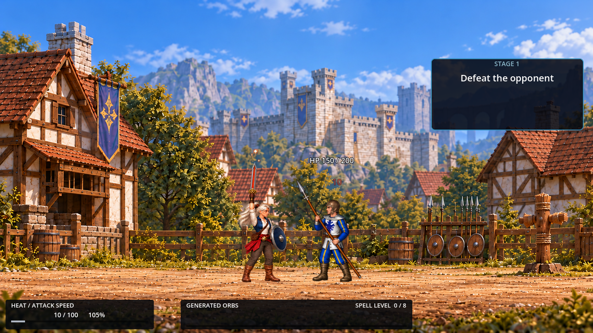
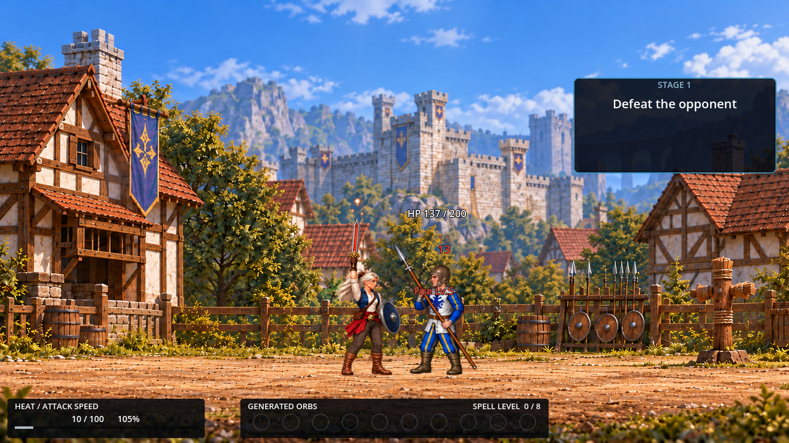

# Overnight Fire combat — morning handoff

October 22, 2026. **Closed at the08:00HKT cutoff; heartbeat deletion confirmed08:00:40.** All retained tuning remains provisional until the user's own controller playtest. No submission clearance is implied.

## Result

Five product-file deltas were retained. The most substantial repair is not artwork: actions started after a Charging-preserved gap now correctly reacquire the movement lock, so their authored lunge is actually applied. Normal RELEASE no longer leaves an orphan Charging/depleting updater running. The orb HUD has ten visible empty slots and no longer widens on overflow. The existing empowered-Cast confirmation is easier to attribute to Laema. X5 has a longer provisional recovery to improve the observed low-Heat endpoint-contact margin.

The night did **not** solve the original artistic ambition by timing alone. X5 still needs a more decisive visual identity, and a successful Cast still lacks a fully developed launch/impact presentation. No replacement art, new AI policy, new mechanic or protected-rule change was introduced to disguise that limit.

## Retained changes

| Owner / file | Change | Cost or boundary |
|---|---|---|
| Fire X5 style | Windup0.45, recovery1.10 instead of original0.63; base1.55s. | Candidate D adds about0.13s first release-to-launch versus A0.95 in the recorded opening. Human patience/weight judgment pending. |
| MightComponent | Reassert the existing movement lock at every actual X/Cast start, including after preserved gaps. | Gap movement remains allowed; no new state, lunge values or movement owner. |
| MagicComponent | Normal initialized RELEASE stops Charging/depleting updater flags before request arbitration. | No orb refund, startup Cast, changed priority, dodge rearm or pressure thresholds. |
| Prototype HUD | Dim empty-slot circles; detach old orb slots before deferred freeing/rebuild. | Existing geometry and whole-widget overflow flinch retained. |
| Player cue | Existing school-colored square moved above Laema; half-size6 local, facingX8/Y-66,0.45s. | Same acceptance/promotion event, not a new launch/impact cue; Fire-only visual evidence. |

U was the sole product-code writer. Combat supplied input data, observations, bounded candidate scopes, review and evidence records. Full source identities are in [FINAL_SOURCE_IDENTITY.json](FINAL_SOURCE_IDENTITY.json):690 baseline non-document paths match root versus tested runtime; exactly the five rows above differ from the preserved post-dodge baseline. Existing unrelated dirty code, scenes, assets and documents were preserved. No commit, push, publication or broad cleanup occurred.

## Evidence and comparisons

**Endpoint interaction:** with original timing, the first five melee hits left Enemy150HP, and the launched empowered Lv5 Cast was rejected by existing reaction invincibility. Retained D's corresponding first Cast applied13 and left137HP. These are actual frames plus recorded outcomes, not mockups or proof of universal superiority.

Before — original timing, Enemy150 after rejected Cast:

After — retained D/Might repair, Enemy137 and Fire Lv5/13 feedback:

The cleaner comparison is the same-Might cohorts: A0.95 won80/70/90HP,6applied/1invincible among7valid high-level contacts; D1.10 won80/90/80HP,7/7applied13. Small unseeded samples do not establish statistical difficulty/survival improvement. D still produced natural failed Casts after new charge presses during hurt. [TIMING_COMPARISON.md](TIMING_COMPARISON.md) preserves rejected B/C and the trade-off.

**Motion/Heat:** same-Might A and final retained D separately earnedHeat4->100 through48normal Fire Lv1 Casts each, with no actor/resource/clock/AI injection and stable authored lunge/retreat. FinalD batch edgesmax18/17/19ms. Only X3 physically reached the short legacy target at that spacing: not Stage7 completion and not high-Heat Pikeman protection. Final D independently accepted a0.43scadence uncharged five-Xchain at100Heat/full35lunge; gap movement, Cast lock/postCast movement and two24tick/.4sdodges also replayed. See [final D evidence](final-d-practice-01/) and PROGRESS07:38; A coverage is not silently transferred.

**Current D pressure and defence:** complete encounters included real incoming damage, held front block and normal return to attacks, dodge windup/prelaunch cancellation, once-only orb consumption/no refund, ignored postlaunch-recovery dodge, a real invincible contact while stopped by a wall, and continuation of the same damaged encounter to victory. Five earlier current-source parry taps failed. A later final-d-parry-01 visible-windup/pause-assisted tap resolvedPARRIED/zeroHealthloss; actualframes showPARRY->PARRIED->READY, followed by a same-encounter victory at70HP. This demonstrates the current path, not human-controller timing comfort. Both misses and pass remain recorded.

**Supplementary regressions:** the five full existing suites passed1741/1236/1337/1281/1617checks:7,212total, zero assertion failures, all exit0. Their setup includes forced actor positions, Heat and animation seeking, including controlled input-path branches. They are not primary gameplay, human-controller or AI/usability evidence. [Reports and logs](final-regressions/) preserve all results and shutdown warnings.

**Presentation:** actual both-facing cue images and ten-slot/overflow/consumed HUD states were inspected. Mali's correction preserved the accepted simple prototype cue and moved it away from victim/weapon overlap; it did not create new artwork or change event meaning. See [VISUAL_REVIEW.md](VISUAL_REVIEW.md). Clean debug-hidden cmd24 and Retry-reloaded cmd26 are distinguished; Retry restores hitbox visibility from saved configuration.

## Important remaining issues

1. **Charging after hurt is unclear.** A new full press during hurt is classified but cannot start Charging; the unchanged hold is not retried. Later release can fail for no charged orbs. That gives a concrete reproducible cause, not proof of the friend's unlogged attempt. The player-facing reason/rearm policy needs a deliberate decision; it was not changed overnight.
2. **A launched spell can still meet reaction protection.** Levels5–8 currently fall back to Impact1; fixed reaction invulnerability remains. Longer X5 recovery helps recorded low-Heat timing, not a demonstrated global high-Heat solution. Neither protected rule was changed.
3. **Feedback is incomplete.** The recent-event lane is still only legacy completed-chain output; no new event formatter/history was implemented. Cast-level text can overlap the Enemy's head/weapon. Invincibility-rejected spells do not receive the same popup as APPLIED zero-damage resistance. These are distinct meaning/presentation issues.
4. **X5 escalation remains an art problem.** Current frames distinguish actions, but timing alone does not deliver a dramatic final silhouette or satisfying Cast impact. Any replacement animation/effects or new simulation consequence remains a proposal for the next session.
5. **Legacy/technical limits:** the small practice target only intersects some new Fire trajectories; objective text clips in the old arena; result-button focus can be lost after Pause. Exit0 still carries13ObjectDB/9resources, with21/13 in a longer completed-job Arena run. No worker was pending in that latter case; cause remains unknown. No teardown fix was improvised.

## Short human-controller check

- Try X chains with deliberate gaps while Charging: does reacquired lunge feel consistent, and does ordinary movement return between actions?
- Judge X5 recovery1.10 versus restorable A0.95: improved weight or too much waiting before Cast?
- Charge during pressure, especially after being hit; check whether the current failure needs clearer information, a different rearm policy, or both.
- Try actual-stick dodge direction and pressured parry. Synthetic/pause-assisted input cannot settle those.
- Judge the above-head empowered cue and successful Cast presentation at normal viewing distance. No audio was captured or auditioned overnight.

## Records and validation boundary

[PROGRESS.md](PROGRESS.md) is the chronological account, including failed/stalled/excluded trials. [TEST_MATRIX.md](TEST_MATRIX.md) separates versions and primary/supplementary coverage. [TIME_LEDGER.md](TIME_LEDGER.md) separates measured gameplay exposure, review, U implementation and waiting; the overnight wall-clock window is not continuous play. Baseline, A/B/C/D manifests and selected captures remain recoverable. The user's normal profile was not overwritten.

Canonical synchronization is scoped to the five retained deltas and directly stale current-state wording in GDD, TDD, Implementation Status, Attack Styles and Gym. [Final document identities](FINAL_DOCUMENT_IDENTITY.json) record the exact five hashes and07:49 recheck of all690 runtime paths. The bounded [implementation review](IMPLEMENTATION_REVIEW.md) found no newly introduced contract violations in those five deltas; that is not whole-game or submission clearance. Candidate freeze took effect07:30. Final user acceptance, analog/controller/parry comfort and audio remain open.

Recorded active-play exposure is approximately35m28s across123gameplay commands, not nine hours of continuous play. Review, U implementation/document work, tests, paused coordination, continuity gaps and waiting are separate; their exact total cannot be reconstructed as a stopwatch. See TIME_LEDGER.md for the method and exclusions. Both unattended phases are excluded from difficulty comparisons rather than concealed.

At the08:00 cutoff the overnight run ended. The product tool confirmed deletion of heartbeat overnight-fire-combat-iteration; its local automation file is absent. The chat and all source/evidence/baseline files were retained. All owned game processes were already closed, U has no pending implementation, and no further candidates were introduced after07:30. Final pre-cutoff source/helper/canonical hashes still matched the recorded identities; whitespace checks passed. [CLOSEOUT.json](CLOSEOUT.json) records the actual result. No commit, push, publication or submission clearance occurred.
